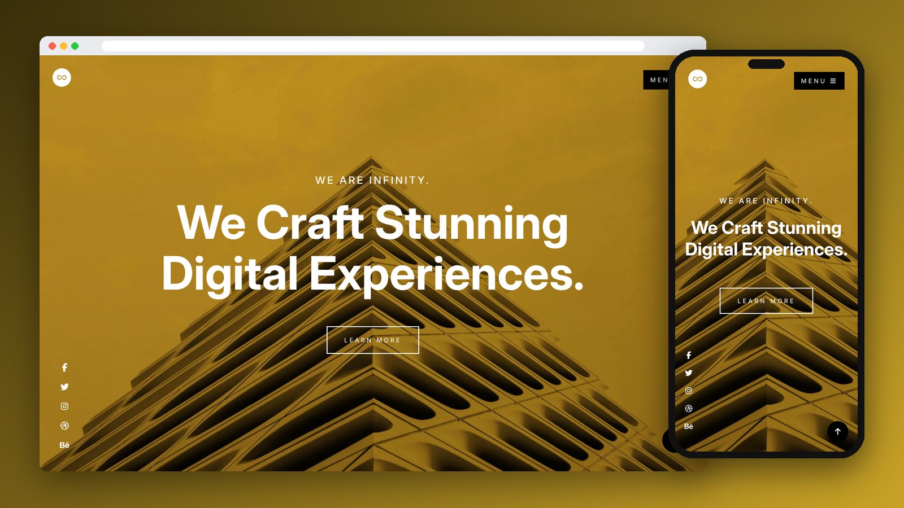

<div align="center">

# Infinity

A bold one-page digital agency website, built with pure HTML and CSS — no JavaScript.

[](https://mo7-adad.github.io/infinity/)

   

</div>

---



## Features

- Full-screen hero with a background image and overlay
- About, services, portfolio and contact sections
- Portfolio grid with hover effects
- Dropdown menu that opens on hover — no JavaScript
- Fully responsive layout using Flexbox, Grid and media queries

## Project Structure

```
infinity/
├── index.html
├── style.css
└── images/
```

## Run Locally

```bash
git clone https://github.com/mo7-adad/infinity.git
cd infinity
```

Then open `index.html` in your browser, or right-click it in VS Code and choose **Open with Live Server**.

## Author

**Mohamed Al-hadad** — Front-End Developer

[](https://github.com/mo7-adad)
